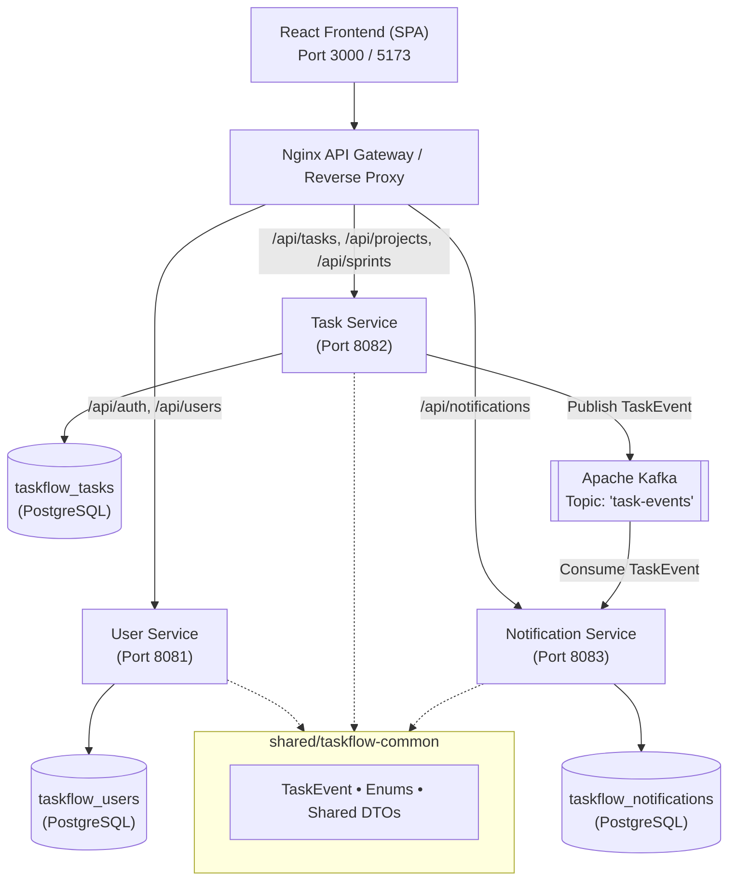

# TASKFLOW — Agile Task & Project Management System

[](https://github.com/taskflow/taskflow/actions)
[](https://openjdk.org/)
[](https://spring.io/projects/spring-boot)
[](https://react.dev/)
[](https://kafka.apache.org/)
[](https://www.docker.com/)

> **TASKFLOW** is a full-featured, enterprise-grade Agile Task & Project Management System modeled after Jira and Linear. It is built to demonstrate a complete **3-semester evolutionary software architecture**: evolving from a clean CRUD monolith into a distributed, event-driven microservices ecosystem.

---

## 🌟 3-Semester Evolutionary Journey

TASKFLOW demonstrates how real-world software evolves cleanly without premature over-engineering:

```
┌─────────────────────────────────┐
│     SEMESTER 1: THE MONOLITH    │  • Spring Boot 3 MVC + Spring Data JPA
│        Clean CRUD Foundation    │  • PostgreSQL with Flyway Migrations (V1, V2, V3)
│                                 │  • Interactive React 18 Kanban Board UI
└────────────────┬────────────────┘
                 │
                 ▼
┌─────────────────────────────────┐
│    SEMESTER 2: ENTERPRISE CORE  │  • JWT Authentication + Role-Based Access Control
│      Security, Filtering, CI    │  • Jira-Style Dynamic Task Filtering & Full-Text Search
│                                 │  • Docker Compose & Automated GitHub Actions CI
└────────────────┬────────────────┘
                 │
                 ▼
┌─────────────────────────────────┐
│    SEMESTER 3: MICROSERVICES    │  • Decomposed: user-service, task-service, notification-service
│     Distributed Event-Driven    │  • Apache Kafka Asynchronous Event Streaming ('task-events')
│                                 │  • Shared DTO library & Database-per-Service Isolation
└─────────────────────────────────┘
```

---

## ⚡ Quick Start: Zero-Config Local Run

You can run the entire application immediately **without needing Docker or a local PostgreSQL instance**. The included `dev` profile uses an embedded in-memory database with PostgreSQL compatibility and automatically seeds sample accounts, projects, sprints, and tasks.

### 1. Start Backend Monolith (Port 8080)
```bash
# Windows
.\mvnw.cmd spring-boot:run -pl backend

# Linux / macOS
./mvnw spring-boot:run -pl backend
```
*Backend runs at `http://localhost:8080` (Swagger UI: `http://localhost:8080/swagger-ui.html`)*

### 2. Start React Frontend (Port 5173)
In a second terminal:
```bash
cd frontend
npm install
npm run dev
```
*Open `http://localhost:5173` in your browser.*

---

## 🔑 Demo Accounts (Pre-Seeded)

The login screen features **one-click role switcher buttons** to quickly test different permission levels:

| Role | Email | Password | Permissions |
| :--- | :--- | :--- | :--- |
| **ADMIN** | `admin@taskflow.com` | `admin123` | Full access across projects, sprints, tasks, and users |
| **MANAGER** | `manager@taskflow.com` | `manager123` | Create & manage projects, sprints, and team tasks |
| **MEMBER** | `member@taskflow.com` | `member123` | View projects/sprints, update status and edit assigned tasks |

---

## 🐳 Docker Deployment Options

### Option 1: Microservices with Kafka (Semester 3)
Deploys PostgreSQL, Apache Kafka (KRaft mode), User Service (8081), Task Service (8082), Notification Service (8083), and the React Frontend + Nginx API Gateway (Port 3000):

```bash
cp .env.example .env
docker compose up --build
```
- Web Application: `http://localhost:3000`
- User Service: `http://localhost:8081`
- Task Service: `http://localhost:8082`
- Notification Service: `http://localhost:8083`

### Option 2: Monolith with PostgreSQL (Semester 2)
Deploys PostgreSQL, the unified Monolith backend (8080), and the Frontend (3000):

```bash
docker compose -f docker-compose.monolith.yml up --build
```

---

## 🏗️ Architecture & Technology Stack

### Tech Stack Matrix
- **Backend:** Java 21 / 25, Spring Boot 3.3.4, Spring Security 6, Spring Data JPA, Hibernate, Flyway.
- **Frontend:** React 18, Vite, React Router v6, Axios, Lucide Icons, Modern CSS.
- **Messaging:** Apache Kafka 3.7.0 (KRaft mode).
- **Persistence:** PostgreSQL 16 (Production) / H2 PostgreSQL mode (Local Dev).
- **DevOps:** Docker, Docker Compose, GitHub Actions CI.
- **Testing:** JUnit 5, Mockito, Spring Boot MockMvc, Vitest.

### Microservice Architecture Overview



---

## 🎯 Key Feature Highlights

### 1. Jira-Style Dynamic Task Filtering & Search
Task endpoints support arbitrary combinations of query parameters with pagination and sorting:
```http
GET /api/tasks?projectId=1&sprintId=1&status=IN_PROGRESS&priority=HIGH&search=Kafka&page=0&size=10&sort=dueDate,asc
```
Built using `TaskSpecification` with JPA CriteriaBuilder — avoiding combinatorial repository method explosion.

### 2. Interactive Kanban Task Board
- 4 Columns: `TODO`, `IN_PROGRESS`, `IN_REVIEW`, `DONE`.
- Status transition buttons (`◀`, `▶`) and quick action buttons.
- Color-coded priority badges (`LOW`, `MEDIUM`, `HIGH`, `CRITICAL`).
- Due date indicators with overdue visual cues.
- Filter toolbar: Filter by project, sprint, assignee, status, priority, or search term in real time.

### 3. Asynchronous Event-Driven Notifications (Kafka)
- When a task is created, assigned, or changes status, `task-service` publishes a `TaskEvent` to Kafka.
- `notification-service` consumes the event and creates an in-app notification for the assignee.
- Users receive live notification badges in the navigation bar.

---

## 🧪 Testing & Verification

Run the entire automated multi-module test suite:

```bash
# Backend Tests (All Modules)
.\mvnw.cmd test

# Frontend Unit Tests
cd frontend && npm test
```

### Test Coverage Highlights:
- **`TaskServiceTest`:** Unit tests verifying business invariants and task CRUD.
- **`AuthServiceTest`:** Password hashing and authentication flows.
- **`TaskControllerTest`:** MockMvc integration testing HTTP responses, bean validation, and security.
- **`UserServiceTest` / `TaskServiceTest` / `NotificationServiceTest`:** Microservice isolation tests.
- **`App.test.jsx` / `Dashboard.test.jsx`:** React UI routing and metric component tests.

---

## 📂 Repository Directory Layout

```
TASKFLOW/
├── .github/
│   └── workflows/ci.yml             # GitHub Actions CI workflow
├── backend/                         # Semester 1 & 2 Monolith Backend
│   ├── src/main/java/com/taskflow/  # Controllers, Services, Repositories, Entities
│   ├── src/main/resources/          # Flyway migrations (V1, V2, V3) & configs
│   ├── src/test/java/               # Unit and MockMvc integration tests
│   └── Dockerfile                   # Multi-stage production Dockerfile
├── frontend/                        # React 18 + Vite Frontend
│   ├── src/components/              # Reusable UI components (Navbar, Modals, etc.)
│   ├── src/pages/                   # Kanban Board, Projects, Sprints, Dashboard
│   ├── src/services/                # Centralized Axios API client services
│   ├── nginx.conf                   # Reverse proxy configuration
│   └── Dockerfile                   # Production Nginx Dockerfile
├── services/                        # Semester 3 Microservices
│   ├── user-service/                # Port 8081: Identity & Authentication
│   ├── task-service/                # Port 8082: Projects, Sprints, Tasks, Kafka Producer
│   └── notification-service/        # Port 8083: Kafka Consumer & Notifications
├── shared/
│   └── taskflow-common/             # Shared DTOs, Enums, and Kafka TaskEvent schema
├── docker/
│   └── init-dbs.sql                 # PostgreSQL multi-database initialization script
├── docs/                            # In-Depth Academic Documentation
│   ├── architecture.md              # Architectural diagrams and design decisions
│   ├── api.md                       # REST API specification & curl examples
│   ├── database.md                  # ERD, Flyway scripts, and schema documentation
│   ├── setup.md                     # Step-by-step local & Docker setup instructions
│   ├── semester-1.md                # Semester 1 requirements and delivery report
│   ├── semester-2.md                # Semester 2 requirements and delivery report
│   ├── semester-3.md                # Semester 3 requirements and delivery report
│   └── testing.md                   # Testing strategy and coverage analysis
├── docker-compose.yml               # Semester 3 Microservices orchestration
├── docker-compose.monolith.yml      # Semester 2 Monolith orchestration
├── .env.example                     # Environment variables template
├── pom.xml                          # Maven Parent Aggregator
└── README.md                        # Master Project Documentation
```

---

## 📚 In-Depth Documentation Links

- 📐 [Architecture & Evolutionary Design](file:///docs/architecture.md)
- 📡 [REST API Specification](file:///docs/api.md)
- 🗄️ [Database Schema & Migrations](file:///docs/database.md)
- 🚀 [Local Setup & Deployment Guide](file:///docs/setup.md)
- 📘 [Semester 1 Report](file:///docs/semester-1.md)
- 📗 [Semester 2 Report](file:///docs/semester-2.md)
- 📙 [Semester 3 Report](file:///docs/semester-3.md)
- 🧪 [Testing Strategy & Coverage](file:///docs/testing.md)

---

## 📄 License
This project is developed for academic evaluation and demonstration of progressive enterprise software architecture.
