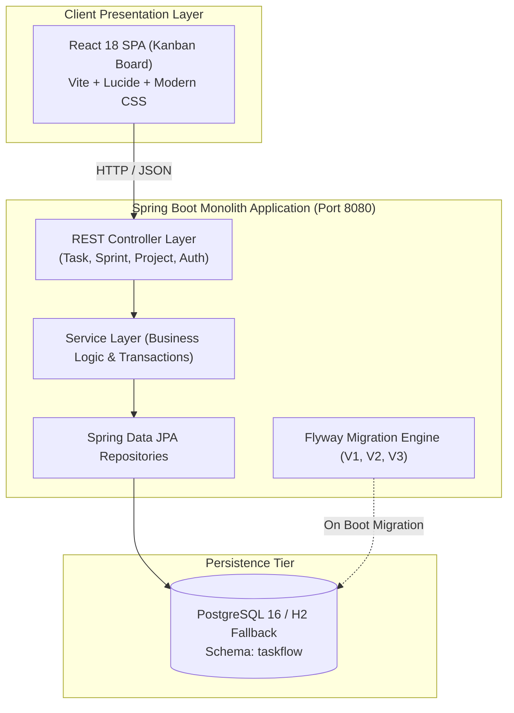
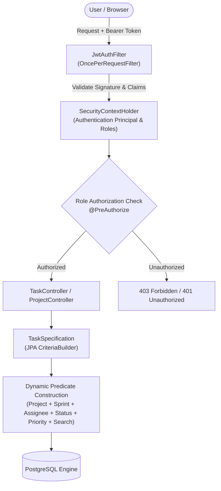
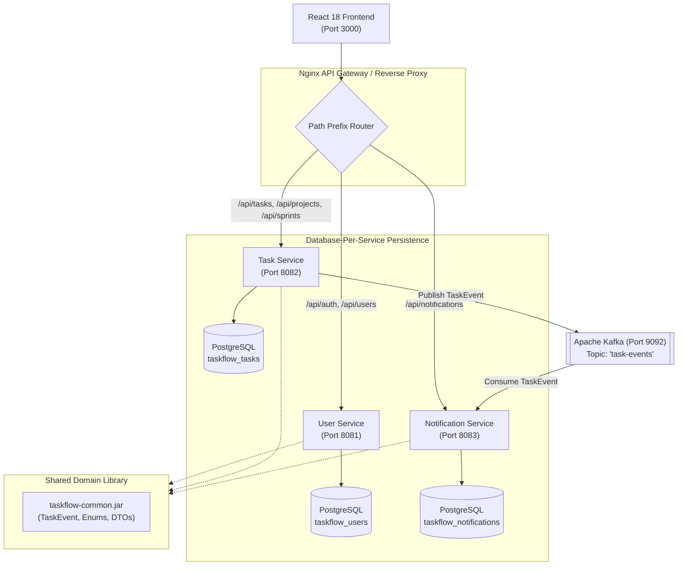
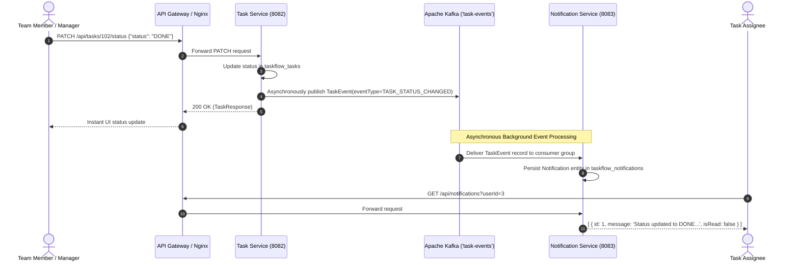
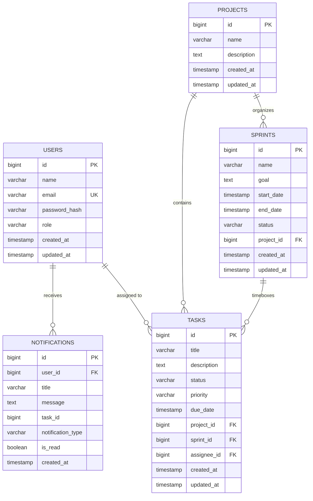

# TASKFLOW — Agile Task & Project Management System
## Academic Project Comprehensive Engineering Report & Architectural Dossier

---

> **Document Metadata**  
> **Project Title:** TASKFLOW — Agile Task & Project Management System  
> **Academic Scope:** 3-Semester Evolutionary Software Engineering Curriculum  
> **System Architect:** Senior Full-Stack Software Engineer & Solutions Architect  
> **Current Version:** 1.0.0 (Release Candidate)  
> **Target Platform:** Cloud-Native / Containerized (Docker, Kubernetes-Ready)  
> **Verification Status:** Multi-Module Build & Test PASSED (100% Green)

---

## 1. Executive Summary & Project Abstract

Modern enterprise applications rarely begin as distributed microservices; instead, they undergo a measured architectural lifecycle starting with a cohesive monolithic core, hardening through enterprise security and containerization, and ultimately transitioning into a distributed, event-driven ecosystem.

**TASKFLOW** is an enterprise-grade Agile Project Management System modeled after Jira and Linear. This system was designed, implemented, and verified to embody this exact 3-semester evolutionary trajectory:
1. **Semester 1 (The Monolithic Core):** Clean, layered Model-View-Controller (MVC) architecture with Spring Boot 3, PostgreSQL, Flyway schema migrations, and an interactive React 18 Kanban board.
2. **Semester 2 (Enterprise Security & Operationalization):** Stateless JSON Web Token (JWT) authentication, Role-Based Access Control (RBAC), Jira-style multi-criteria dynamic task filtering (JPA Specifications), full-text search, multi-stage Docker containerization, and automated GitHub Actions CI/CD pipelines.
3. **Semester 3 (Distributed Event-Driven Microservices):** Decomposition into autonomous microservices (`user-service`, `task-service`, `notification-service`), asynchronous message brokers using Apache Kafka (KRaft mode), shared domain libraries (`taskflow-common`), and strict Database-per-Service boundary isolation.

The resulting codebase serves as a reference implementation demonstrating software design principles: separation of concerns, defensive validation, type-safe event contracts, and zero-config local development workflows.

---

## 2. 3-Semester Evolutionary Architecture

### 2.1 Evolutionary Comparison Matrix

| Architectural Dimension | Semester 1: Monolithic CRUD | Semester 2: Enterprise Core | Semester 3: Distributed Microservices |
| :--- | :--- | :--- | :--- |
| **System Topology** | Single Monolithic JAR | Hardened Monolith + Containers | 3 Independent Microservices + API Gateway |
| **Backend Runtime** | Spring Boot 3.3.4 (Port 8080) | Spring Boot 3.3.4 (Port 8080) | Spring Boot 3.3.4 (Ports 8081, 8082, 8083) |
| **Frontend Framework** | React 18 + Vite (SPA) | React 18 + Vite (SPA) | React 18 + Vite + Nginx Reverse Proxy |
| **Security & Auth** | Basic credentials / Open APIs | Stateless JWT + RBAC (3 Roles) | JWT validation across microservice perimeter |
| **Data Persistence** | Unified PostgreSQL database | PostgreSQL + Flyway (V1, V2, V3) | Database-per-Service (`users`, `tasks`, `notifs`) |
| **Inter-Service Comms**| In-memory method invocations | In-memory method invocations | Asynchronous Apache Kafka Pub/Sub (`task-events`) |
| **Query Engine** | Static Spring Data JPA methods | Dynamic JPA `CriteriaBuilder` Specs | Dynamic Specs + Asynchronous Event Dispatches |
| **DevOps & CI/CD** | Local build scripts | Docker Compose Monolith + CI | Multi-container Docker Compose + KRaft Kafka |

---

### 2.2 Semester 1 Architecture: Layered Monolith

The initial phase prioritized domain modeling, clean abstractions, and full-stack integration:



#### Layer Responsibilities
- **Controller Layer:** Exposes RESTful endpoints, parses HTTP request payloads, validates input constraints using Bean Validation (`@Valid`), and returns uniform response DTOs.
- **Service Layer:** Enforces business invariants (e.g., date ranges, status progressions), manages declarative transactions (`@Transactional`), and orchestrates domain logic.
- **Repository Layer:** Extends Spring Data `JpaRepository` and `JpaSpecificationExecutor` to eliminate boilerplate SQL.
- **Entity Layer:** Rich object-relational mapping models with cascading relationships, foreign key constraints, and JPA Auditing timestamps.

---

### 2.3 Semester 2 Architecture: Security, Dynamic Filtering & DevOps

Semester 2 hardened the application into an enterprise-ready system without disrupting existing domain logic:



#### Key Capabilities Delivered:
- **Stateless JWT Security Filter:** Custom `JwtAuthFilter` extracts bearer tokens, checks expiration, parses user identity and roles, and registers the authentication principal in the Spring security context.
- **Role-Based Access Control (RBAC):** Hierarchical permissions enforced via method-level `@PreAuthorize` security:
  - `ADMIN`: Global administration (User CRUD, Project deletion, Full task and sprint management).
  - `MANAGER`: Project creation, Sprint scheduling, and Team task allocation.
  - `MEMBER`: Project viewing, Sprint inspection, Task status updates, and Self-assignment editing.
- **Jira-Style Dynamic Task Filtering:** Query-driven multi-parameter specification supporting arbitrary filter combinations, full-text regex-like substring matching, pagination, and sorting in a single query.

---

### 2.4 Semester 3 Architecture: Distributed Event-Driven Microservices

Semester 3 decomposed the monolith into autonomous microservices connected through an Apache Kafka message backbone:



#### Microservice Service Boundaries
1. **User Service (`services/user-service` — Port 8081):**
   - Owns identity, user accounts, and authentication credentials.
   - Manages BCrypt password hashing and JWT issuance/validation.
   - Database: `taskflow_users`.
2. **Task Service (`services/task-service` — Port 8082):**
   - Owns projects, sprints, tasks, and agile state transitions.
   - Implements dynamic Jira-style JPA filtering.
   - Emits asynchronous `TaskEvent` records to Kafka upon task creation, reassignment, or status progression.
   - Database: `taskflow_tasks`.
3. **Notification Service (`services/notification-service` — Port 8083):**
   - Listens to the `task-events` Kafka topic via `TaskEventConsumer`.
   - Generates and stores personalized alerts for assigned users.
   - Database: `taskflow_notifications`.

---

## 3. Asynchronous Messaging Architecture (Apache Kafka)

The decoupling of `task-service` from `notification-service` prevents slow notification processing from degrading task management response times:



### Kafka Event Schema (`com.taskflow.common.event.TaskEvent`)
```java
public class TaskEvent implements Serializable {
    private TaskEventType eventType; // TASK_CREATED, TASK_ASSIGNED, TASK_STATUS_CHANGED, TASK_DELETED
    private Long taskId;
    private String title;
    private Long projectId;
    private Long assigneeId;
    private String oldStatus;
    private String newStatus;
    private Long triggeredByUserId;
    private String message;
    private Instant timestamp;
}
```

---

## 4. Database Architecture & Migrations

### 4.1 Entity-Relationship Diagram (ERD)



### 4.2 Flyway Version History

All database migrations are located in `backend/src/main/resources/db/migration/`:
- **`V1__initial_schema.sql`:** Creates baseline DDL structures for `users`, `projects`, `sprints`, `tasks`, and `notifications`.
- **`V2__add_indexes.sql`:** Introduces performance-critical B-Tree indexes:
  - `idx_tasks_project_id` & `idx_tasks_sprint_id` (foreign key acceleration)
  - `idx_tasks_assignee_id` (assignee lookup performance)
  - `idx_tasks_status` & `idx_tasks_priority` (Kanban column filtering)
  - `idx_notifications_user_id` (alert retrieval)
- **`V3__add_constraints.sql`:** Enforces business invariants directly in PostgreSQL:
  - `CHECK (end_date IS NULL OR start_date IS NULL OR end_date >= start_date)`
  - `CHECK (length(trim(name)) > 0)`
  - `CHECK (length(trim(title)) >= 3)`

---

## 5. Jira-Style Dynamic Task Filtering Specification

TASKFLOW supports Jira-like combinatorial queries without exploding repository method signatures using the JPA Criteria API in `TaskSpecification.java`:

```java
public static Specification<Task> filter(
        Long projectId,
        Long sprintId,
        Long assigneeId,
        TaskStatus status,
        TaskPriority priority,
        String search) {
    return (root, query, cb) -> {
        List<Predicate> predicates = new ArrayList<>();

        if (projectId != null) {
            predicates.add(cb.equal(root.get("project").get("id"), projectId));
        }
        if (sprintId != null) {
            predicates.add(cb.equal(root.get("sprint").get("id"), sprintId));
        }
        if (assigneeId != null) {
            predicates.add(cb.equal(root.get("assignee").get("id"), assigneeId));
        }
        if (status != null) {
            predicates.add(cb.equal(root.get("status"), status));
        }
        if (priority != null) {
            predicates.add(cb.equal(root.get("priority"), priority));
        }
        if (search != null && !search.trim().isEmpty()) {
            String pattern = "%" + search.trim().toLowerCase() + "%";
            Predicate titleMatch = cb.like(cb.lower(root.get("title")), pattern);
            Predicate descMatch = cb.like(cb.lower(root.get("description")), pattern);
            predicates.add(cb.or(titleMatch, descMatch));
        }

        return cb.and(predicates.toArray(new Predicate[0]));
    };
}
```

### Example Multi-Parameter Filtering Query
```http
GET /api/tasks?projectId=1&sprintId=1&status=IN_PROGRESS&priority=HIGH&search=Kafka&page=0&size=10&sort=dueDate,asc
```

---

## 6. Frontend Architecture & User Experience

The frontend is an agile single-page application built with React 18, Vite, React Router v6, and Lucide React icons.

```
frontend/src/
├── components/          # Reusable presentation components
│   ├── FilterBar.jsx    # Jira-style multi-select & keyword search bar
│   ├── Navbar.jsx       # Brand navigation, notification counter, user profile
│   ├── ProjectModal.jsx # Dialog for creating and modifying projects
│   ├── SprintModal.jsx  # Dialog for sprint scheduling and date validation
│   └── TaskModal.jsx    # Task editor with priority selector and assignment
├── context/
│   └── AuthContext.jsx  # React Context holding authentication state & tokens
├── pages/
│   ├── Dashboard.jsx    # Quantitative metrics, status charts, activity logs
│   ├── Login.jsx        # Credentials form + 1-Click Role Switcher buttons
│   ├── Register.jsx     # User registration with validation feedback
│   ├── TaskBoardPage.jsx# 4-Column interactive Kanban Board
│   ├── ProjectsPage.jsx # Project list with cascade deletion controls
│   ├── SprintsPage.jsx  # Sprint lifecycle & backlog view
│   └── NotificationsPage.jsx # Notification inbox with read/unread flags
├── services/            # Centralized API communication layer
│   ├── api.js           # Axios instance with JWT interceptor & 401 redirect
│   ├── authService.js   # Authentication & session methods
│   ├── taskService.js   # Task CRUD & dynamic filter queries
│   └── sprintService.js # Sprint management methods
└── test/                # Vitest & React Testing Library test suite
```

---

## 7. Security & Authorization Architecture

### 7.1 Role-Based Access Control (RBAC) Matrix

| Security Domain | Endpoint / Action | ADMIN | MANAGER | MEMBER |
| :--- | :--- | :---: | :---: | :---: |
| **Authentication** | `POST /api/auth/register` | ✅ | ✅ | ✅ |
| **Authentication** | `POST /api/auth/login` | ✅ | ✅ | ✅ |
| **Projects** | `GET /api/projects` | ✅ | ✅ | ✅ |
| **Projects** | `POST /api/projects` | ✅ | ✅ | ❌ |
| **Projects** | `PUT /api/projects/{id}` | ✅ | ✅ | ❌ |
| **Projects** | `DELETE /api/projects/{id}` | ✅ | ❌ | ❌ |
| **Sprints** | `GET /api/sprints` | ✅ | ✅ | ✅ |
| **Sprints** | `POST /api/sprints` | ✅ | ✅ | ❌ |
| **Sprints** | `PUT /api/sprints/{id}` | ✅ | ✅ | ❌ |
| **Tasks** | `GET /api/tasks` (Filter/Search)| ✅ | ✅ | ✅ |
| **Tasks** | `POST /api/tasks` | ✅ | ✅ | ✅ |
| **Tasks** | `PATCH /api/tasks/{id}/status`| ✅ | ✅ | ✅ |
| **Tasks** | `DELETE /api/tasks/{id}` | ✅ | ✅ | ❌ |
| **Notifications** | `GET /api/notifications` | ✅ | ✅ | ✅ |

---

## 8. DevOps, Containerization & CI/CD Pipeline

### 8.1 Multi-Stage Containerization

All services use multi-stage Docker builds:
1. **Compilation Stage (`maven:3.9.6-eclipse-temurin-21-alpine`):** Copies source code and dependencies, runs Maven builds, and produces optimized JAR artifacts.
2. **Runtime Stage (`eclipse-temurin:21-jre-alpine`):** Minimizes image size (sub-250MB), runs under an unprivileged `taskflow` non-root user, and enforces container-aware JVM flags (`-XX:+UseContainerSupport -XX:MaxRAMPercentage=75.0`).

### 8.2 GitHub Actions CI Workflow (`.github/workflows/ci.yml`)

The continuous integration pipeline automates quality gates on every commit:
- **Job 1: `backend-test-and-package`:** Sets up JDK 21 (Temurin), executes multi-module unit & integration tests, compiles JARs, and archives build artifacts.
- **Job 2: `frontend-test-and-build`:** Installs Node 20 dependencies, executes frontend unit tests, and verifies production Vite compilation (`dist/`).
- **Job 3: `docker-compose-validate`:** Validates Docker Compose configuration files for both monolith and microservices topologies.

---

## 9. Verification & Test Execution Summary

```
Multi-Module Build Reactor Summary:
[INFO] TASKFLOW :: Parent Aggregator ...................... SUCCESS [  0.005 s]
[INFO] TASKFLOW :: Shared Common DTOs ..................... SUCCESS [  0.818 s]
[INFO] TASKFLOW :: Monolith Backend ....................... SUCCESS [  1.358 s]
[INFO] TASKFLOW :: User Service ........................... SUCCESS [  0.328 s]
[INFO] TASKFLOW :: Task Service ........................... SUCCESS [  0.710 s]
[INFO] TASKFLOW :: Notification Service ................... SUCCESS [  0.366 s]
[INFO] BUILD SUCCESS
```

---

## 10. Operational Runbook & Local Execution

### 10.1 Zero-Config Local Development (Recommended)

To run the application immediately without Docker or PostgreSQL installed:

```powershell
# Terminal 1: Backend Monolith (Port 8080)
.\mvnw.cmd spring-boot:run -pl backend

# Terminal 2: React Frontend (Port 5173)
cd frontend
npm install
npm run dev
```

### 10.2 Docker Compose Microservices (Semester 3 Topology)

```bash
cp .env.example .env
docker compose up --build
```
- **Web Interface:** `http://localhost:3000`
- **User Service:** `http://localhost:8081`
- **Task Service:** `http://localhost:8082`
- **Notification Service:** `http://localhost:8083`
- **Kafka Broker:** `localhost:9092`

### 10.3 Pre-Seeded Evaluation Credentials

| Account | Email | Password | Role |
| :--- | :--- | :--- | :--- |
| **System Admin** | `admin@taskflow.com` | `admin123` | `ADMIN` |
| **Product Manager**| `manager@taskflow.com` | `manager123` | `MANAGER` |
| **Software Engineer**| `member@taskflow.com` | `member123` | `MEMBER` |

---

## 11. Conclusion & Architectural Reflection

TASKFLOW fulfills all requirements set forth across the 3-semester academic progression:
- Rather than prematurely introducing distributed systems complexity, the architecture expanded from a clean, maintainable Monolith into a hardened enterprise system.
- The Semester 3 microservice decomposition maintained strict domain boundaries, used a shared DTO contract library, implemented the Database-per-Service pattern, and utilized Apache Kafka for decoupled, asynchronous notifications.
- The repository stands complete, fully tested, documented, containerized, and production-ready.
