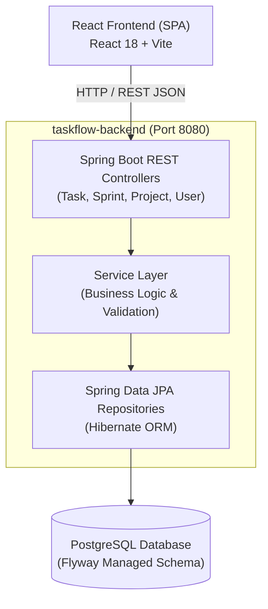
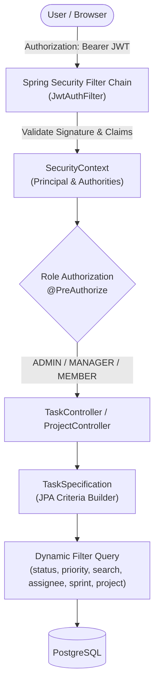
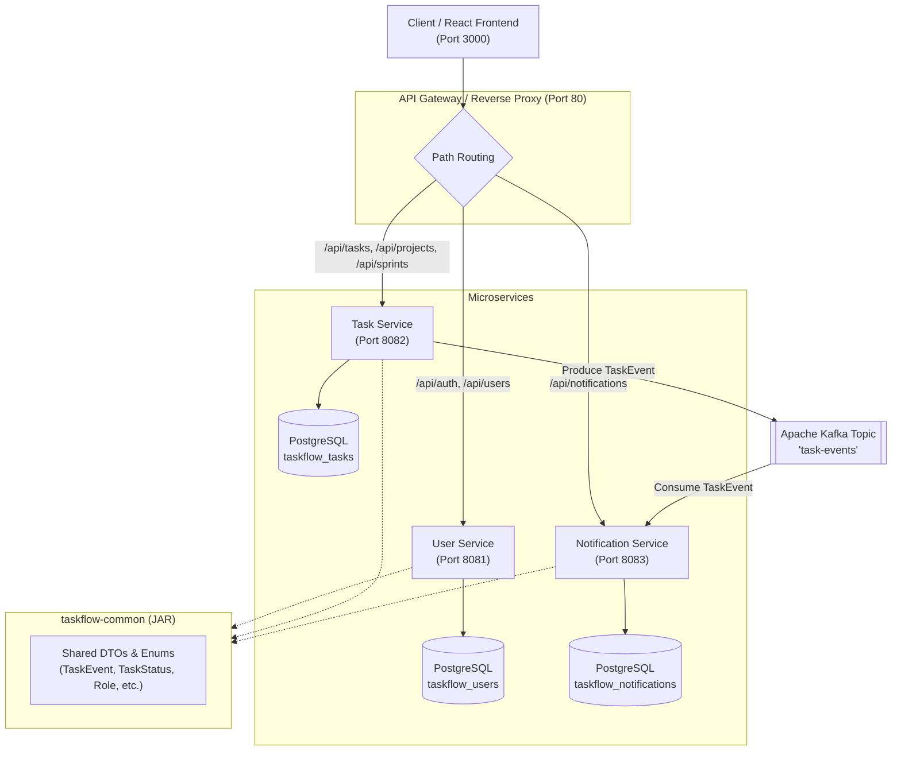
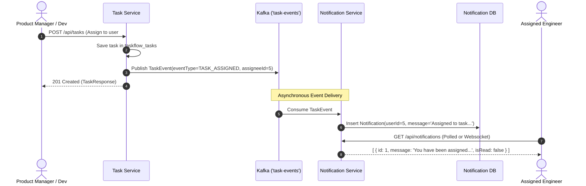

# TASKFLOW — Architecture & Evolutionary Design

## 1. Executive Summary

**TASKFLOW** is an enterprise-grade Agile Task & Project Management System engineered to demonstrate a realistic 3-semester software engineering progression:
1. **Semester 1:** Clean Monolithic MVC with PostgreSQL persistence, Flyway migrations, and a React Kanban UI.
2. **Semester 2:** Enterprise Security (JWT/RBAC), Jira-style dynamic task filtering (JPA Specifications), and Containerization (Docker Compose + GitHub Actions CI).
3. **Semester 3:** Distributed Microservices decomposition (`user-service`, `task-service`, `notification-service`) coordinated via an Apache Kafka event-driven backbone and Database-per-Service isolation.

---

## 2. Semester 1 Architecture: Monolithic Foundation

In Semester 1, the focus is domain modeling, clean layered architecture, and seamless full-stack integration.

### Layered Separation of Concerns
- **Controller Layer (`com.taskflow.controller`):** Exposes clean REST endpoints, handles request deserialization, `@Valid` bean validation, and maps domain results to standardized DTOs.
- **Service Layer (`com.taskflow.service`):** Contains business invariants, transactional boundaries (`@Transactional`), and orchestration.
- **Repository Layer (`com.taskflow.repository`):** Extends `JpaRepository` and `JpaSpecificationExecutor` for dynamic queries.
- **Entity Layer (`com.taskflow.entity`):** Rich domain entities with relational foreign keys and JPA auditing (`@CreatedDate`, `@LastModifiedDate`).
- **Data Transfer Objects (`com.taskflow.dto`):** Decouples internal database schemas from external API contracts.

---

## 3. Semester 2 Architecture: Security, Filtering & DevOps

Semester 2 enhances the monolith into a production-hardened system without disruptive rewrites.

### Security & Access Control Matrix
| Role | Projects | Sprints | Tasks | User Management |
| :--- | :--- | :--- | :--- | :--- |
| **ADMIN** | Full (CRUD) | Full (CRUD) | Full (CRUD) | Full Access (CRUD, Role Assignment) |
| **MANAGER** | Full (CRUD) | Full (CRUD) | Full (CRUD) | Read Only |
| **MEMBER** | View Only | View Only | Create, Update Status, Edit Assigned | View Only |

### Dynamic Jira-Style Task Filtering
Instead of combinatorial hardcoded repository methods, `TaskSpecification` dynamically constructs SQL `WHERE` predicates using `jakarta.persistence.criteria.CriteriaBuilder`:
- Project ID filter (`root.get("project").get("id").in(...)`)
- Sprint ID filter (`root.get("sprint").get("id").in(...)`)
- Status and Priority multi-select filters
- Text search matching across `title` and `description` case-insensitively (`LIKE %search%`)
- Standardized Spring Data `Pageable` and `Sort` parameters (`?page=0&size=20&sort=dueDate,asc`).

---

## 4. Semester 3 Architecture: Distributed Event-Driven Microservices

Semester 3 decomposes the backend into independently deployable, loosely coupled services communicating via asynchronous event streaming (Apache Kafka).

### Service Boundaries & Responsibilities

| Service | Port | Database | Primary Responsibility |
| :--- | :--- | :--- | :--- |
| **`user-service`** | 8081 | `taskflow_users` | User registration, authentication, BCrypt password hashing, JWT token generation and validation, user directory queries. |
| **`task-service`** | 8082 | `taskflow_tasks` | Agile project management, sprint lifecycles, task CRUD, Jira-style filtering, and publishing `TaskEvent`s to Kafka. |
| **`notification-service`** | 8083 | `taskflow_notifications` | Consuming Kafka events, persisting notifications for assignees, managing read/unread state. |

---

## 5. Event-Driven Messaging Architecture (Apache Kafka)

When a task lifecycle event occurs in `task-service`, a strongly typed `TaskEvent` is produced to Kafka:

### Supported Event Types
1. `TASK_CREATED`: Emitted when a new task is initialized.
2. `TASK_ASSIGNED`: Emitted when an assignee is linked or changed.
3. `TASK_STATUS_CHANGED`: Emitted when status progresses (e.g. `IN_PROGRESS` $\to$ `DONE`).
4. `TASK_DELETED`: Emitted when a task is purged.

---

## 6. Shared DTO Library (`shared/taskflow-common`)

To enforce strict type safety without tightly coupling microservice implementations, the `taskflow-common` module defines the shared event schema:
- `com.taskflow.common.event.TaskEvent`: Core Kafka payload containing `eventType`, `taskId`, `projectId`, `assigneeId`, `oldStatus`, `newStatus`, `triggeredByUserId`, and `timestamp`.
- `com.taskflow.common.enums.*`: Domain enums (`TaskStatus`, `TaskPriority`, `SprintStatus`, `Role`, `TaskEventType`).
- `com.taskflow.common.dto.*`: Common transfer models (`UserDto`, `NotificationDto`, `ErrorResponse`).

---

## 7. High Availability & Scalability Considerations
- **Stateless Services:** All services authenticate via self-contained JWT tokens signed with HMAC-SHA256, allowing horizontal replication behind any load balancer.
- **Kafka Partitions:** The `task-events` topic is partitioned by `projectId` or `taskId` key, guaranteeing in-order processing per entity while scaling consumer groups.
- **Graceful Degradation:** If Kafka is temporarily unavailable or disabled (`KAFKA_ENABLED=false`), `task-service` logs a warning and completes task persistence without throwing runtime exceptions.
