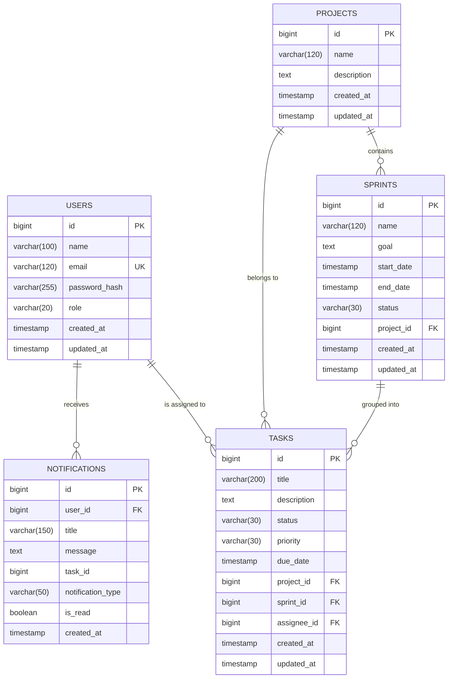

# TASKFLOW — Database Design & Migrations

## 1. Entity-Relationship Diagram (ERD)

The database schema is designed with strict relational constraints, referential integrity, and query performance optimization.

---

## 2. Table Specifications & Columns

### `users`
Stores user identity, role-based authorization levels, and BCrypt-hashed credentials.
- `id` (BIGSERIAL, Primary Key)
- `name` (VARCHAR(100), NOT NULL)
- `email` (VARCHAR(120), NOT NULL, UNIQUE)
- `password_hash` (VARCHAR(255), NOT NULL)
- `role` (VARCHAR(20), NOT NULL, Default: `'MEMBER'`) — Values: `ADMIN`, `MANAGER`, `MEMBER`
- `created_at` (TIMESTAMP WITH TIME ZONE, NOT NULL)
- `updated_at` (TIMESTAMP WITH TIME ZONE, NOT NULL)

### `projects`
Top-level container for Agile initiatives and epics.
- `id` (BIGSERIAL, Primary Key)
- `name` (VARCHAR(120), NOT NULL)
- `description` (TEXT)
- `created_at` (TIMESTAMP WITH TIME ZONE, NOT NULL)
- `updated_at` (TIMESTAMP WITH TIME ZONE, NOT NULL)

### `sprints`
Timeboxed development iterations bound to a specific project.
- `id` (BIGSERIAL, Primary Key)
- `name` (VARCHAR(120), NOT NULL)
- `goal` (TEXT)
- `start_date` (TIMESTAMP WITH TIME ZONE)
- `end_date` (TIMESTAMP WITH TIME ZONE)
- `status` (VARCHAR(30), NOT NULL, Default: `'PLANNED'`) — Values: `PLANNED`, `ACTIVE`, `COMPLETED`
- `project_id` (BIGINT, Foreign Key referencing `projects(id)` ON DELETE CASCADE)
- `created_at` (TIMESTAMP WITH TIME ZONE, NOT NULL)
- `updated_at` (TIMESTAMP WITH TIME ZONE, NOT NULL)

### `tasks`
Atomic units of work tracked across Kanban board states.
- `id` (BIGSERIAL, Primary Key)
- `title` (VARCHAR(200), NOT NULL)
- `description` (TEXT)
- `status` (VARCHAR(30), NOT NULL, Default: `'TODO'`) — Values: `TODO`, `IN_PROGRESS`, `IN_REVIEW`, `DONE`
- `priority` (VARCHAR(30), NOT NULL, Default: `'MEDIUM'`) — Values: `LOW`, `MEDIUM`, `HIGH`, `CRITICAL`
- `due_date` (TIMESTAMP WITH TIME ZONE)
- `project_id` (BIGINT, Foreign Key referencing `projects(id)` ON DELETE CASCADE)
- `sprint_id` (BIGINT, Foreign Key referencing `sprints(id)` ON DELETE SET NULL)
- `assignee_id` (BIGINT, Foreign Key referencing `users(id)` ON DELETE SET NULL)
- `created_at` (TIMESTAMP WITH TIME ZONE, NOT NULL)
- `updated_at` (TIMESTAMP WITH TIME ZONE, NOT NULL)

### `notifications`
Alerts generated by task assignments or status transitions.
- `id` (BIGSERIAL, Primary Key)
- `user_id` (BIGINT, NOT NULL)
- `title` (VARCHAR(150), NOT NULL)
- `message` (TEXT, NOT NULL)
- `task_id` (BIGINT)
- `notification_type` (VARCHAR(50), NOT NULL) — e.g. `TASK_ASSIGNED`, `STATUS_CHANGE`
- `is_read` (BOOLEAN, NOT NULL, Default: `false`)
- `created_at` (TIMESTAMP WITH TIME ZONE, NOT NULL)

---

## 3. Flyway Migration Version History

Database changes are managed sequentially through Flyway scripts in `backend/src/main/resources/db/migration/`:

### `V1__initial_schema.sql`
Creates core relational tables: `users`, `projects`, `sprints`, `tasks`, `notifications` with primary keys and foreign key constraints.

### `V2__add_indexes.sql`
Optimizes dynamic query execution for Jira-style task filtering by establishing B-Tree indexes:
- `idx_tasks_project_id` ON `tasks(project_id)`
- `idx_tasks_sprint_id` ON `tasks(sprint_id)`
- `idx_tasks_assignee_id` ON `tasks(assignee_id)`
- `idx_tasks_status` ON `tasks(status)`
- `idx_tasks_priority` ON `tasks(priority)`
- `idx_tasks_due_date` ON `tasks(due_date)`
- `idx_notifications_user_id` ON `notifications(user_id)`
- `idx_notifications_is_read` ON `notifications(is_read)`

### `V3__add_constraints.sql`
Enforces relational domain invariants at the database engine level:
- Sprint date integrity check: `CHECK (end_date IS NULL OR start_date IS NULL OR end_date >= start_date)`
- Non-empty project name check: `CHECK (length(trim(name)) > 0)`
- Non-empty task title check: `CHECK (length(trim(title)) >= 3)`

---

## 4. Microservices Database-Per-Service Pattern

In Semester 3, services isolate their persistence layers to maintain loose coupling:
1. `taskflow_users` (owned exclusively by `user-service`)
2. `taskflow_tasks` (owned exclusively by `task-service`)
3. `taskflow_notifications` (owned exclusively by `notification-service`)

Services never query or join another service's tables directly. Instead, references (such as `assignee_id`) are stored as foreign identifier values, and cross-service communication occurs via DTOs and Kafka events.
