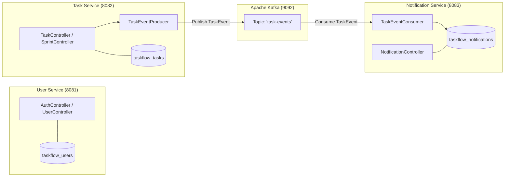

# TASKFLOW — Semester 3: Microservices & Event-Driven Architecture

## 1. Overview & Objectives

In Semester 3, TASKFLOW completes its architectural evolution by transitioning from a monolithic application into a distributed, event-driven microservices ecosystem.

### Key Deliverables Completed:
1. **Decomposed Services:**
   - **`user-service` (Port 8081):** Identity provider, JWT issuance, user directory.
   - **`task-service` (Port 8082):** Agile projects, sprints, tasks, Jira-style filtering, and Kafka event publishing.
   - **`notification-service` (Port 8083):** Kafka event consumer, notification persistence, read/unread status.
2. **Event-Driven Messaging (Apache Kafka):** Asynchronous task event streaming on topic `task-events`.
3. **Shared DTO Library (`shared/taskflow-common`):** Reusable domain enums, transfer objects, and event schemas.
4. **Database-Per-Service Pattern:** Isolated schemas (`taskflow_users`, `taskflow_tasks`, `taskflow_notifications`).
5. **Observability & Health Checks:** Spring Boot Actuator health and metrics endpoints on every microservice.
6. **Docker Orchestration (`docker-compose.yml`):** Unified orchestration of PostgreSQL, Apache Kafka (KRaft mode), 3 microservices, and React Frontend + API Gateway.

---

## 2. Microservice Decomposition & Boundaries



### Microservice Directory Layout:
```
services/
├── user-service/
│   ├── src/main/java/com/taskflow/userservice/
│   │   ├── config/ (JwtUtils, JwtAuthFilter, SecurityConfig, DataInitializer)
│   │   ├── controller/ (AuthController, UserController)
│   │   ├── dto/ (AuthRequest, AuthResponse, RegisterRequest)
│   │   ├── entity/ (User)
│   │   ├── repository/ (UserRepository)
│   │   └── service/ (AuthService, UserService)
│   ├── src/main/resources/ (application.yml, application-dev.yml)
│   ├── Dockerfile
│   └── pom.xml
├── task-service/
│   ├── src/main/java/com/taskflow/taskservice/
│   │   ├── config/ (KafkaProducerConfig, SecurityConfig)
│   │   ├── controller/ (TaskController, ProjectController, SprintController)
│   │   ├── dto/ (TaskRequest, TaskResponse, SprintRequest, ProjectRequest)
│   │   ├── entity/ (Task, Project, Sprint)
│   │   ├── repository/ (TaskRepository, TaskSpecification, SprintRepository, ProjectRepository)
│   │   └── service/ (TaskService, ProjectService, SprintService, TaskEventProducer)
│   ├── src/main/resources/ (application.yml, application-dev.yml)
│   ├── Dockerfile
│   └── pom.xml
└── notification-service/
    ├── src/main/java/com/taskflow/notificationservice/
    │   ├── config/ (SecurityConfig)
    │   ├── consumer/ (TaskEventConsumer)
    │   ├── controller/ (NotificationController)
    │   ├── entity/ (Notification)
    │   ├── repository/ (NotificationRepository)
    │   └── service/ (NotificationService)
    ├── src/main/resources/ (application.yml, application-dev.yml)
    ├── Dockerfile
    └── pom.xml
```

---

## 3. Shared Library (`shared/taskflow-common`)

The shared Maven module avoids code duplication while preserving loose coupling:
- **`com.taskflow.common.event.TaskEvent`:** Serializable Kafka event payload:
  ```java
  public class TaskEvent implements Serializable {
      private TaskEventType eventType; // TASK_CREATED, TASK_ASSIGNED, TASK_STATUS_CHANGED, TASK_DELETED
      private Long taskId;
      private String title;
      private Long projectId;
      private Long assigneeId;
      private String oldStatus;
      private String newStatus;
      private Long triggeredByUserId;
      private String message;
      private Instant timestamp;
      // constructors, getters, setters
  }
  ```
- **Domain Enums:** `TaskStatus`, `TaskPriority`, `SprintStatus`, `Role`, `NotificationType`, `TaskEventType`.
- **Common DTOs:** `UserDto`, `NotificationDto`, `ErrorResponse`.

---

## 4. Asynchronous Event-Driven Flow (Apache Kafka)

### 1. Producer (`TaskEventProducer.java` in `task-service`)
When a task is created or updated, `task-service` sends an event to Kafka asynchronously:
```java
public void sendTaskEvent(TaskEvent event) {
    if (!kafkaEnabled) {
        log.info("Kafka disabled; skipping event: {}", event);
        return;
    }
    String key = String.valueOf(event.getTaskId());
    kafkaTemplate.send(topicTaskEvents, key, event)
        .whenComplete((result, ex) -> {
            if (ex != null) {
                log.error("Failed to publish task event: {}", event, ex);
            } else {
                log.info("Published TaskEvent to [{}]: type={} taskId={}",
                    topicTaskEvents, event.getEventType(), event.getTaskId());
            }
        });
}
```

### 2. Consumer (`TaskEventConsumer.java` in `notification-service`)
`notification-service` listens to the `task-events` topic:
```java
@KafkaListener(topics = "${taskflow.kafka.topics.task-events:task-events}", groupId = "notification-group")
public void handleTaskEvent(TaskEvent event) {
    log.info("Received Kafka TaskEvent: {}", event);
    if (event.getAssigneeId() == null) return;

    Notification notification = Notification.builder()
        .userId(event.getAssigneeId())
        .taskId(event.getTaskId())
        .notificationType(event.getEventType().name())
        .title(buildTitle(event.getEventType()))
        .message(event.getMessage())
        .isRead(false)
        .createdAt(Instant.now())
        .build();

    notificationRepository.save(notification);
    log.info("Created notification from Kafka event for user {}: {}", event.getAssigneeId(), event.getMessage());
}
```

---

## 5. Microservices Docker Deployment

Running all microservices with Kafka KRaft and PostgreSQL:
```bash
docker compose up --build
```
The unified Nginx reverse proxy routes requests seamlessly based on URL path prefixes:
- `/api/auth/*` $\to$ `user-service:8081`
- `/api/users/*` $\to$ `user-service:8081`
- `/api/tasks/*` $\to$ `task-service:8082`
- `/api/projects/*` $\to$ `task-service:8082`
- `/api/sprints/*` $\to$ `task-service:8082`
- `/api/notifications/*` $\to$ `notification-service:8083`

---

## 6. Verification and Health Monitoring

Every microservice exposes health and metrics at `/actuator/health`:
```bash
# Verify User Service Health
curl http://localhost:8081/actuator/health

# Verify Task Service Health
curl http://localhost:8082/actuator/health

# Verify Notification Service Health
curl http://localhost:8083/actuator/health
```
All services return `{"status":"UP"}`.
